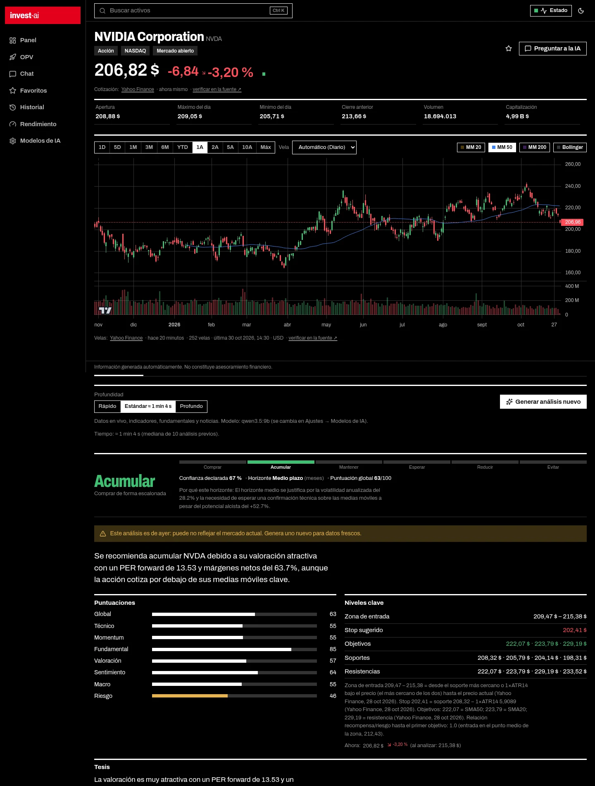
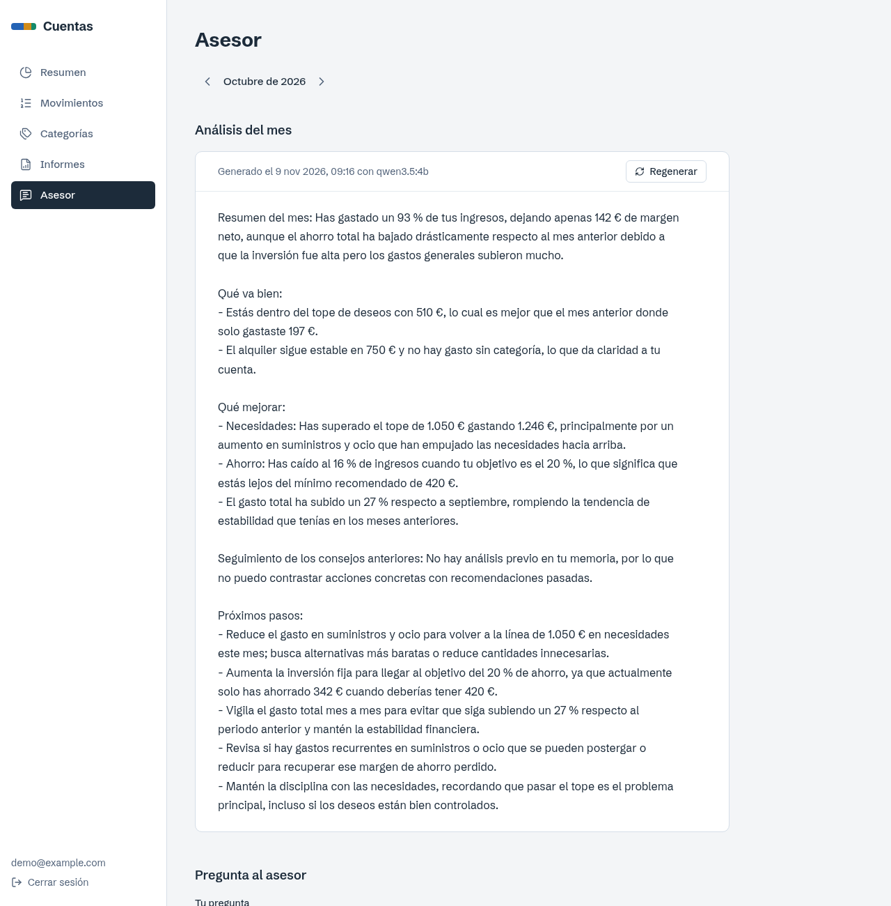

  
  
  
  

**Sergio Rodríguez** · full stack and AI engineer in **Go, Rust and TypeScript** · Madrid, Spain

I build complete products, from the database to the interface, and add AI you can check: the code computes the figures and the model explains them, citing its sources. If the model states a number that is not in the data, it gets flagged or dropped.

Currently working as a **Full Stack & AI Engineer** at [Galdeca TSF](https://galdecatsf.com/). Native Spanish, English B2.

## AI you can check

I use models that run locally and tie them to the data.

### [invest-ai](https://github.com/Chuwi12/invest-ai) · investment analysis with a local LLM

It assesses whether an asset looks like a good investment using live market data and a local LLM on Ollama. A verifier flags or drops any model figure that is not in the data, and every claim cites its source.

- **1,200+ tests**: 931 backend and 286 frontend.
- Chat with **tool calling** over live data and **hybrid RAG** (FTS5 and embeddings).
- Publishes its own backtest although the result is unflattering: none of the 12 preregistered tests cleared the threshold.
- Private by construction: the model runs locally and the server only listens on loopback.

`Rust` `axum` `SQLite` `React` `TypeScript` `Ollama` `RAG`

**[View code →](https://github.com/Chuwi12/invest-ai)**

 

### [Cuentas](https://github.com/Chuwi12/cuentas) · 50/30/20 finance with a local AI advisor

It splits income between needs, wants and savings, and an advisor on a local LLM reviews each month. Rust computes the figures and the model only explains them. Data never leaves the machine.

- **150 backend tests** and 73 for the advisor.
- **Memory with RAG**: every analysis and conversation is stored with its embedding in pgvector.
- The LangChain.js service has no access to the finance database: it only sees the figures Rust passes to it.

`Rust` `axum` `sqlx` `PostgreSQL` `pgvector` `LangChain.js` `React` `Ollama`

**[View code →](https://github.com/Chuwi12/cuentas)** · screenshot with demo data

 

### [Final-project chatbot](https://github.com/Chuwi12/TFG-) · team project

An Angular interface, a Python API with FastAPI and our own language model trained with PyTorch. `Angular` `FastAPI` `PyTorch`

## End-to-end platforms

Complete SaaS products: domain, API, database, interface and deployment.

| Project | What it does | Stack | Proof |
| :-- | :-- | :-- | :-- |
| **HR management suite** | Time tracking, shifts, payroll, documents and messaging on **17 Go microservices** that talk through events. End-to-end encrypted chat, 300+ commits. | Go · PostgreSQL · React · Docker | [Code on request](mailto:sergio.rodriguez.ev@gmail.com?subject=HR%20suite%20source%20code) |
| **Nexora** | Modular CRM/ERP where each client only sees the modules it pays for. Strict data isolation, **< 50 ms** responses, invoicing with legal numbering. | Rust · PostgreSQL · Angular · Docker | [Code on request](mailto:sergio.rodriguez.ev@gmail.com?subject=Nexora%20source%20code) |
| **Taberna La Alcuza** | Website, online booking and a live admin panel for a fictional restaurant. No overbooking: capacity is checked inside a SQLite transaction. | Astro · React · SQLite · Zod | [Live demo](https://taberna-alcuza.vercel.app) |
| **Atelier Ledger** | Accounting SaaS for freelancers with an immutable audit trail, Excel import and exportable reports. | Rust · axum · React · Turso · Clerk | [Live demo](https://contabilidad-frontend-three.vercel.app) |
| **Cuadre** | Accounting for Spanish freelancers and SMEs. Hexagonal architecture, TOTP sign-in and brute-force protection. | Rust · Redis · React | [Code on request](mailto:sergio.rodriguez.ev@gmail.com?subject=Cuadre%20source%20code) |
| **Portfolio** | Static, bilingual site with light and dark themes and no client framework. | Astro · TypeScript | [Code](https://github.com/Chuwi12/portfolioWeb) · [Site](https://www.chuwi-dev.me/en/) |

## Stack

| Area | Technologies |
| :-- | :-- |
| **Languages** | Go · Rust · TypeScript · Java · Python · Kotlin |
| **Applied AI** | Ollama · LangChain.js · RAG · pgvector · PyTorch |
| **Backend & data** | axum · PostgreSQL · Redis · MySQL · SQLite · MongoDB · REST/OpenAPI |
| **Frontend** | React · Angular · Astro · Vite · Tailwind CSS |
| **Infrastructure** | Docker · AWS · Linux · Git · Vercel |
| **Architecture & security** | Microservices · hexagonal · multi-tenant · WebSockets · JWT · MFA/TOTP · end-to-end encryption |

## Background

- **Full Stack & AI Engineer**, [Galdeca TSF](https://galdecatsf.com/) · Nov 2026 — Present
- **Salesforce Full Stack Developer**, VASS · internship, 2026
- **Frontend Developer**, CRC · internship, 2025
- **Network Technician**, Erasmus placement · spring 2024
- **Multiplatform Application Development**, higher vocational diploma · 2024–2026
- **Microcomputer Systems and Networks**, IES Virgen de la Paloma · 2022–2024
- **Cybersecurity**, Masterd Mind AC

## Let's talk

If you need someone who takes a product from the database to the AI, email me or download my CV.

**[sergio.rodriguez.ev@gmail.com](mailto:sergio.rodriguez.ev@gmail.com)** · [CV (PDF)](https://www.chuwi-dev.me/CV-en.pdf) · [CV en español](https://www.chuwi-dev.me/CV.pdf) · [LinkedIn](https://es.linkedin.com/in/sergio-rodr%C3%ADguez-p%C3%A9rez-a57240392) · [Portfolio](https://www.chuwi-dev.me/en/)
